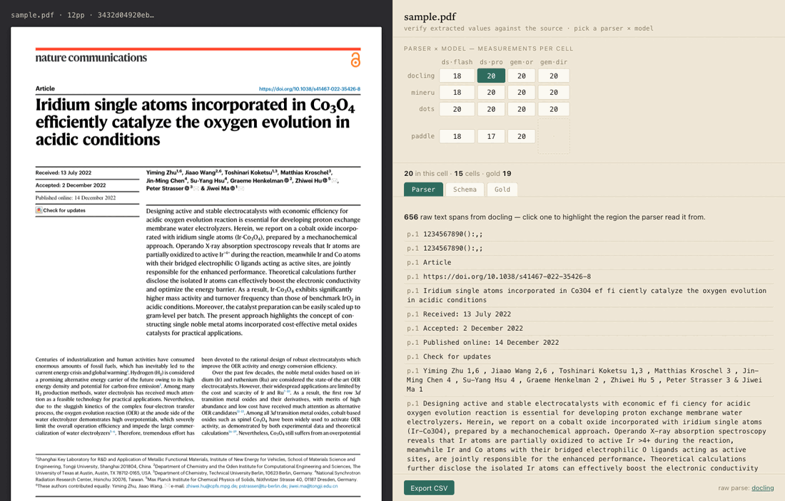
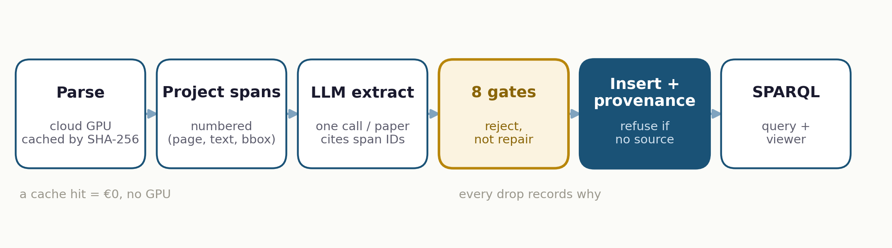
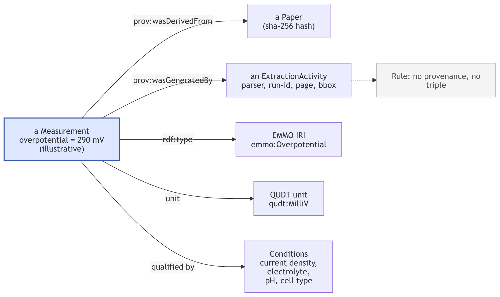
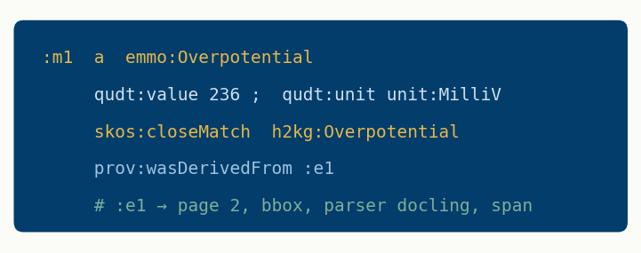
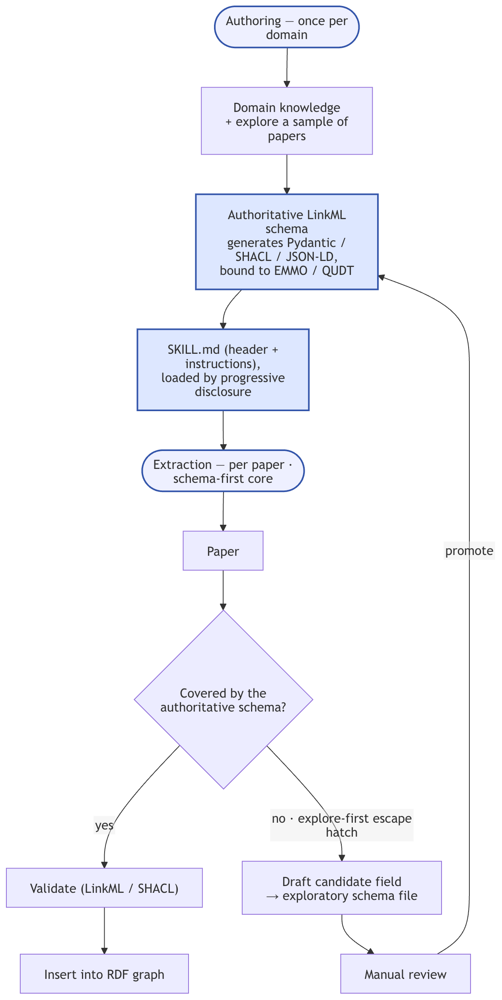
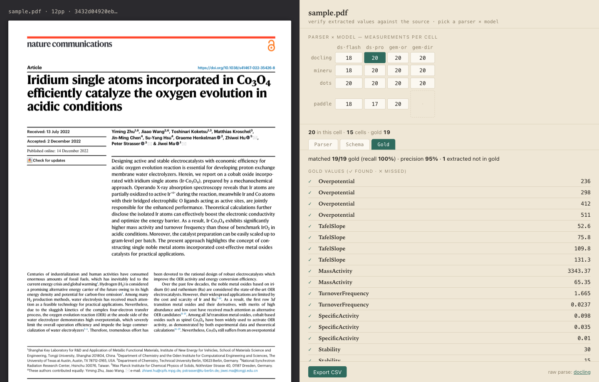

<h1 align="center">palimpsest</h1>

<p align="center">
  <em>An AI research agent that reads scientific papers and writes what it finds into an<br>
  ontology-aligned knowledge graph, where every number points back to the page it came from.</em>
</p>

<p align="center">
  
  
  
  
  
</p>

<p align="center">
  
</p>

<!-- DEMO-VIDEO: replace with the 40 s demo GIF + YouTube walkthrough link before release -->

## Contents

- [What it does](#what-it-does)
- [Why the name](#why-the-name)
- [How it works](#how-it-works)
- [Trust by construction](#trust-by-construction)
- [Ontology grounding](#ontology-grounding)
- [FAIR data, honestly](#fair-data-honestly)
- [An agent with fences](#an-agent-with-fences)
- [New domains are files, not code](#new-domains-are-files-not-code)
- [Quickstart](#quickstart)
- [Three ways to run it](#three-ways-to-run-it)
- [Choosing models](#choosing-models)
- [Parsing your own PDFs](#parsing-your-own-pdfs)
- [Limits](#limits)
- [Project layout](#project-layout)
- [Credits](#credits)

## What it does

The figures of merit in electrocatalysis (overpotential at 10 mA cm⁻², Tafel slope, mass
activity, stability) are scattered across thousands of PDFs. Comparing them means
retyping them by hand. Language models can pull them out, but you can't tell which
numbers they got right.

palimpsest is an agent you point at a folder of papers. It parses each PDF, extracts the
quantities you care about, and checks every value **in code** before it is allowed into
an RDF knowledge graph. Each value is typed with community ontology terms and carries
its provenance: paper hash, parser, page, bounding box and run. You can query across
papers with SPARQL, or click any number in the viewer and see it highlighted on the
original page.

The demonstration domain is acidic oxygen evolution (OER) for PEM water electrolysis.
The agent itself is domain-general: a new domain is a new skill file.

## Why the name

A palimpsest is a manuscript page that was scraped and written over, where the earlier
layers stay readable underneath. palimpsest works the same way: each value keeps the
layer it came from (the page region of the source PDF), and corrections are added on
top as new, linked records instead of overwriting the original.

## How it works

<p align="center">
  
</p>

1. **Parse once.** A document parser (docling, MinerU, dots.ocr, PaddleOCR or Chandra)
   turns the PDF into text with page coordinates. The output is cached under the
   SHA-256 of the PDF bytes, so no paper is parsed twice.
2. **Number the spans.** The parsed text is cut into numbered spans, each with a page
   and a bounding box.
3. **Extract.** A language model, guided by a domain skill, returns measurements and
   cites the span ids it read them from. It never writes provenance itself.
4. **Check in code.** Eight gates reject (never repair) anything that does not hold up.
5. **Insert with provenance.** Code attaches the paper hash, parser, page, bounding box
   and run id from the cited spans. No source, no triple.
6. **Use it.** SPARQL, marimo notebooks, and the click-to-source viewer.

## Trust by construction

The language model proposes; the code decides. A value enters the graph only if it
passes all of these checks:

| Gate | What it checks |
|---|---|
| Output format | The reply parses as the expected JSON |
| Span resolution | Every cited span id exists in this paper's parse |
| Digits in span | The value's digits actually appear in the cited text |
| Schema | The record instantiates a class of the LinkML schema |
| Units | The unit reduces to the right base dimensions for that quantity |
| Magnitude | The value is within a plausible ceiling for its quantity |
| SHACL | The RDF node satisfies the closed SHACL shape |
| Provenance | No evidence (paper, parser, page, bbox, run) → refused at insert |

Each rejection is logged with its reason, so you can see why a value is missing.

<p align="center">
  
</p>

## Ontology grounding

One LinkML schema (`schema/palimpsest.yaml`) generates the Pydantic models, the SHACL
shapes, the JSON-LD context and the JSON Schema shown to the model, so they cannot drift
apart. Its terms come from community ontologies:

- **EMMO / ECHO** (the EMMO electrochemistry domain): 4 of the 11 measurement classes
  bind directly to ECHO terms (overpotential, exchange current density, charge-transfer
  coefficient, ECSA). The other 7 are local classes, proposed as ECHO extensions.
- **H2KG**, the hydrogen knowledge graph from the AIMWORKS project: 9 of 11 classes carry
  a `skos:closeMatch` to an H2KG term.
- **QUDT** units with UCUM codes, and **PROV-O** for provenance.
- The ontology versions are pinned by SHA-256, and every IRI the schema uses resolves.

<p align="center">
  
</p>

## FAIR data, honestly

palimpsest aims to make published results FAIR after the fact, one corpus at a time.
Where it stands today:

- **Reusable:** yes. Every value is typed, carries a unit, and traces to the page
  region it was read from.
- **Interoperable:** partly. QUDT units and the direct ECHO bindings hold; the local
  classes are still proposals.
- **Findable:** partly. Values are findable by query inside the graph, but instance
  IRIs do not resolve publicly yet.
- **Accessible:** not yet. The graph is a local store with no published endpoint.

## An agent with fences

palimpsest's own agent works like a coding agent spawned in a workspace: it reads
freely, writes notebooks and notes, runs shell commands, and calls the pipeline. The
things that would make that reckless are closed in code, not asked for in a prompt:

| Invariant | How | Where |
|---|---|---|
| Writes stay in the workspace | `write_file` / `edit_file` resolve paths and refuse anything outside it | `policy.py` |
| The shell can't escape either | `bash` runs under an OS sandbox (macOS Seatbelt, Linux bwrap), fail-closed | `sandbox.py` |
| The graph is pipeline-only | Triples enter only through extraction, with provenance | `pipeline.py`, `store.py` |
| Spend has a hard cap | A cost meter is checked before every paid call (€50 by default, `/budget` to change) | `cost.py` |
| Everything is undoable | Each action is a git checkpoint inside the workspace; `/undo` restores | `versioning.py` |

## New domains are files, not code

Domain knowledge lives in `skills/<group>/<name>/SKILL.md`: a YAML header that names the
schema classes it targets, plus the notes a domain expert would give a new student
(which conditions make a value meaningful, what to skip). The loader checks every skill
against the live schema and tool registry, and quarantines a broken skill instead of
crashing.

<p align="center">
  
</p>

Shipped skills: `oer-extraction` and `pemwe-anode` (domain); `notebook-analysis`,
`marimo-pairing`, `report-writing` and `ontology-extension` (general). A new domain
such as HER, CO₂ reduction or battery materials is a new skill folder, plus new schema
classes proposed in `schema/exploratory.yaml`.

## Quickstart

Requires [pixi](https://pixi.sh) on macOS (Apple silicon) or Linux x86-64.

```bash
git clone https://github.com/sleipnir029/palimpsest.git
cd palimpsest
pixi install
pixi run test          # optional, offline
```

Four open-access example papers ship in `papers/` with their parser outputs in
`cache/` (see [papers/README.md](papers/README.md)), so you can try everything without a
GPU.

## Three ways to run it

### 1. With your own coding agent (no API key)

Already use Claude Code, Codex, OpenCode, Cursor or a similar coding agent? Open it in
this folder and ask, for example:

> Extract the OER measurements from papers/s41467-022-35426-8.pdf into the knowledge
> graph, then tell me which catalyst has the lowest overpotential at 10 mA/cm².

The agent reads [AGENTS.md](AGENTS.md) and acts as the extraction model on your existing
subscription. palimpsest still runs every check and attaches provenance in code. Under
the hood:

```bash
pixi run python -m palimpsest prompt papers/<paper>.pdf --out workspace/prompt.md
# the coding agent reads the prompt and writes workspace/answer.json
pixi run python -m palimpsest ingest papers/<paper>.pdf --response workspace/answer.json
```

### 2. The palimpsest terminal agent (bring any API key)

```bash
cp .env.example .env   # add a key, or paste it when the TUI asks
pixi run tui
```

Chat with the agent, watch each tool call stream past, and keep an eye on the budget
bar. Useful slash commands: `/use` (switch models), `/budget`, `/cost`, `/view` (open the
viewer), `/undo`, `/git`, `/issues`, `/help`.

One-shot from the command line: `pixi run python -m palimpsest "<request>"`.

### 3. The provenance viewer

```bash
pixi run viewer        # http://localhost:8765
```

Open a paper, pick a parser, and click any value to jump to its box on the PDF page.
RocksDB allows one writer, so stop the viewer while an extraction is running.

<p align="center">
  
</p>

## Choosing models

Use whichever provider you have a key for:

| Role | Providers | Switch with |
|---|---|---|
| Agent loop | DeepSeek (default, `deepseek-v4-flash`), Anthropic (Claude) | `/use orchestration <provider> [model]` |
| Extraction | DeepSeek (default), Anthropic, Gemini, OpenRouter | `/use extraction <provider> [model]` |

The default is DeepSeek because it is cheap: one paper costs around a cent. Keys go in
`.env` (see [.env.example](.env.example)). Every paid call is metered against the
budget cap.

## Parsing your own PDFs

Drop PDFs into `papers/`. A PDF without a cached parse is parsed on a cloud GPU via
[RunPod](https://runpod.io):

1. Build the parser images in [docker/](docker/) (see `docker/README.md` and
   `docker/runpod-template.md`).
2. Create a RunPod template per parser and set `RUNPOD_API_KEY` and
   `RUNPOD_TEMPLATE_<PARSER>` in `.env`.

The pod starts, parses, is billed against the budget, and shuts down. The output is
cached, so each PDF is parsed once per parser.

## Limits

- **Valid is not the same as correct.** The gates prove that a value is well-formed,
  in the right units and traceable to its source. They do not prove the paper was read
  the way a scientist would read it, so check what matters. That is what the viewer is
  for.
- **Small evaluation so far.** The extraction was evaluated on five OER papers. A larger
  held-out set and a second domain are the next steps.

## Project layout

```
src/palimpsest/      the engine
  agent.py           the agent loop (build_agent(), shared by CLI and TUI)
  tools/             registered tools: bash, read/write/edit_file, sparql_query,
                     extract_paper, workspace_status, open_notebook, read_skill, ...
  pipeline.py        parse → extract → validate → insert
  store.py           RDF store with provenance-enforced insertion (pyoxigraph)
  external.py        bring-your-own-agent prompt / ingest
  policy.py          workspace confinement
  sandbox.py         OS sandbox for bash
  cost.py            budget meter (SQLite ledger)
  versioning.py      per-action git checkpoints + /undo
  skills.py          SKILL.md loader and validation
  tui/  viewer/      terminal UI; FastAPI + PDF.js viewer
schema/              LinkML schema + generated Pydantic, SHACL, JSON-LD, JSON Schema
skills/              SKILL.md folders (domain/, general/)
papers/  cache/      example papers and their parser outputs
docker/              parser images for RunPod
notebooks/           marimo notebook templates
tests/               offline test suite
```

Stack: Python 3.11, pixi, Anthropic SDK (DeepSeek / Anthropic wire format), pyoxigraph,
SQLite, dulwich, LinkML, Textual + Rich, FastAPI + PDF.js + HTMX, marimo. No agent
framework, no MCP servers, no vector database: one hand-written agent loop and plain
Python function calls.

## Credits

palimpsest started as an MSc mini-thesis in Materials Engineering at RWTH Aachen
University, carried out at IET-3 (Theory and Computation of Energy Materials),
Forschungszentrum Jülich. Thanks to Prof. Michael Eikerling, Dr. Mehrtoos Eslamibidgoli
and Dr. Kourosh Malek for supervision and for the ontology work this builds on.

Ontologies: [EMMO](https://emmo-repo.github.io/) and its electrochemistry domain ECHO,
[QUDT](https://qudt.org), [PROV-O](https://www.w3.org/TR/prov-o/), and
[H2KG](https://vimilabs.github.io/AIMWORKS/) from the AIMWORKS project. Example papers
are CC BY 4.0; see [papers/README.md](papers/README.md).

## License

[MIT](LICENSE) © 2026 Rahat Rakibuzzaman
